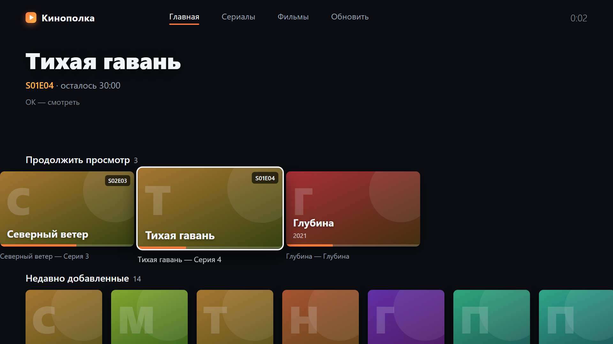
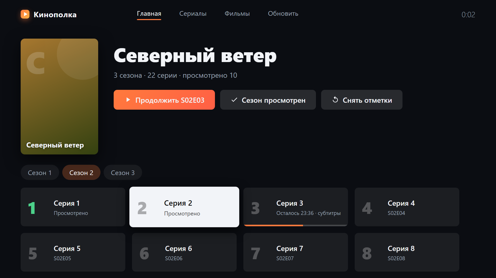
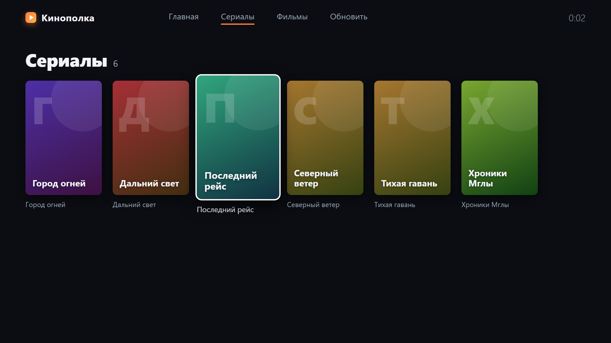
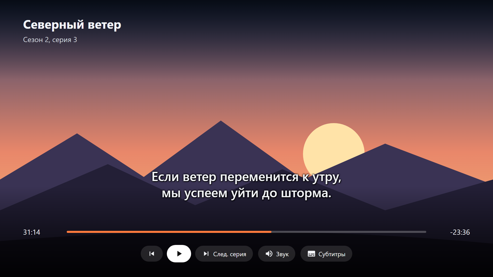
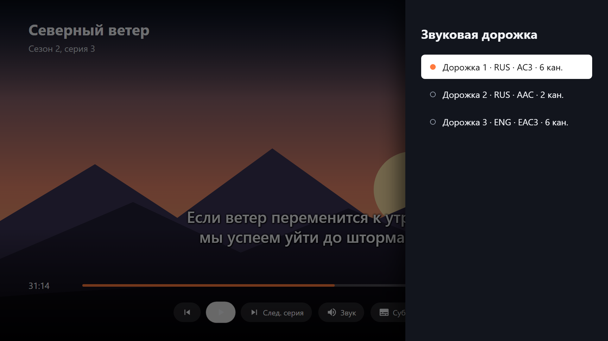

# Кинополка

**Свой домашний «стриминг» для Samsung TV.** Скачанные фильмы и сериалы лежат на компьютере,
а смотришь их на телевизоре в нормальном интерфейсе под пульт: с постерами, сезонами,
«продолжить просмотр», выбором озвучки и субтитров.

Кидаешь скачанное в одну папку, а Кинополка сама понимает, где фильм, а где серия, и раскладывает
всё по полкам: сериал → сезон → серия.



| Сериал: сезоны и серии | Вся библиотека |
|---|---|
|  |  |
| **Плеер с субтитрами** | **Выбор озвучки** |
|  |  |

<sub>Скриншоты сняты на демо-библиотеке с выдуманными названиями (`tools/screenshots.py`).</sub>

## Возможности

- 📂 **Автосортировка.** Понимает имена из раздач (`Show.Name.S01E02.1080p.WEB-DL`, `1x02`, «Сезон 4/05.mkv», «Серия 3», `Movie.2023.BDRip`), вырезает мусор вроде `1080p`, `x265` и названий студий, переносит субтитры вместе с видео. Недокачанные файлы не трогает.
- 🧲 **Загрузка торрентов.** Кидаешь `.torrent` в `media/torrents` — Кинополка скачает раздачу и отправит её в сортировку. Нужен libtorrent (см. ниже).
- 📺 **Приложение для Tizen.** Навигация пультом, крупный интерфейс для просмотра с дивана.
- ▶️ **Родной плеер Samsung (AVPlay).** Играет MKV, MP4, AVI и TS с H.264/HEVC и AC3/EAC3/AAC — всё, что умеет сам телевизор.
- 🔊 **Несколько озвучек в одном файле.** Переключаются прямо во время просмотра.
- 💬 **Субтитры.** Внешние `.srt` и `.ass` (включая русские в cp1251) и встроенные в MKV.
- ⏯ **Продолжить просмотр.** Позиция запоминается, а после серии автоматически включается следующая.
- ✅ **Отметки «просмотрено»** для серий и целых сезонов.
- 🪶 **Без зависимостей.** Сервер — один файл на чистом Python 3, база данных не нужна. Видео отдаётся как есть, без перекодирования: качество оригинальное, и компьютер не нагружается.

## Как это устроено

```
 ПК (Windows/Linux/macOS)                          Samsung TV
┌───────────────────────────────┐     Wi-Fi /     ┌─────────────────────────┐
│ media/inbox  ← скачанное      │      LAN        │  приложение «Кинополка» │
│   │ sorter.py (раз в минуту)  │ ◄─────────────► │  интерфейс + AVPlay     │
│   ▼                           │   HTTP :8090    └─────────────────────────┘
│ media/movies, media/series    │
│ server.py — API + видеопоток  │
└───────────────────────────────┘
```

Библиотека на диске:

```
media/
├── torrents/                   ← сюда .torrent-файлы
├── downloads/                  ← здесь качаются торренты
├── inbox/                      ← кидай сюда файлы или целые папки раздач
├── movies/
│   └── Название (2023)/
│       ├── Название (2023).mkv
│       ├── Название (2023).rus.srt
│       └── poster.jpg          ← необязательно
└── series/
    └── Название сериала/
        ├── poster.jpg          ← необязательно
        └── Сезон 01/
            ├── Название сериала S01E01.mkv
            └── Название сериала S01E02.mkv
```

Без постера рисуется цветная обложка с названием. Чтобы был постер, положи `poster.jpg` в папку фильма или сериала, а для красивого размытого фона ещё и `backdrop.jpg`.

## Быстрый старт

Нужен **Python 3.7+**. Больше ничего ставить не надо.

```bash
git clone https://github.com/mj11rock/kinopolka.git
cd kinopolka
python3 server.py
```

Сервер покажет адрес вида `http://192.168.0.10:8090`. Открой его в браузере на ПК или телефоне — это тот же интерфейс, что и на ТВ.
Затем положи что-нибудь в `media/inbox` и подожди минуту или нажми «Обновить».

Настройки лежат в `config.json`:

```json
{
  "media_dir": "media",
  "port": 8090,
  "auto_sort": true
}
```

`media_dir` может указывать на любую папку, например `D:/Video`.

### Торренты

Загрузчик работает на [libtorrent](https://libtorrent.org/), на том же движке, что и qBittorrent. Ставится один раз:

```bash
sudo apt install python3-libtorrent
```

Если libtorrent не установлен, сервер работает как обычно, просто без загрузок.

1. Положи `.torrent` в `media/torrents`. Сервер подхватит его за несколько секунд, прогресс пишется в консоль раз в минуту.
2. Раздача качается в `media/downloads`. Когда она докачается целиком, файлы переезжают в `inbox` и сортируются как обычно, а торрент переименовывается в `.torrent.done`.
3. После загрузки раздача не продолжается. Если перезапустить сервер, загрузка продолжится с того же места.
4. Чтобы отменить загрузку, удали `.torrent` из `media/torrents`: недокачанные файлы сотрутся.

Порт для входящих соединений задаётся параметром `"torrent_port"` (по умолчанию 6881), отключить загрузчик можно параметром `"torrents": false` в `config.json`.
Порт открывать не обязательно: загрузчик сам подключается к пирам. Без открытого порта к тебе не смогут подключиться другие, так что на редких раздачах пиров может быть меньше.

```bash
python3 torrents.py           # загрузчик без сервера
```

### Сортировка вручную

```bash
python3 sorter.py --dry-run   # показать, что куда переедет
python3 sorter.py             # разложить
python3 sorter.py --watch     # следить за inbox без сервера
```

Если сортировщик не узнал файл, он оставит его в `inbox`. Тогда переложи файл руками по схеме выше.

## Установка на телевизор

Интерфейс можно открыть и во встроенном браузере ТВ по адресу сервера. Но браузер телевизора плохо понимает MKV, AC3 и DTS и не умеет переключать озвучку.
Приложение играет через родной плеер Samsung, поэтому лучше поставить его. Это делается один раз:

1. Установи [Tizen Studio](https://developer.samsung.com/smarttv/develop/getting-started/setting-up-sdk/installing-tv-sdk.html), а в Package Manager добавь **TV Extensions** и **Samsung Certificate Extension**.
2. Включи на ТВ режим разработчика: **Приложения** → набери на пульте `1 2 3 4 5` → Developer mode **On** → впиши IP компьютера → перезагрузи ТВ.
3. В Tizen Studio открой **Tools → Certificate Manager** → «+» → **Samsung** → TV и создай профиль `tv`. Понадобится аккаунт Samsung.
4. Собери и установи приложение:
   ```bash
   python3 tools/make_tizen.py --tv <IP телевизора>
   ```
   Адрес сервера вшивается в приложение при сборке. Если он поменяется, приложение покажет экран «Нет связи» с кнопкой «Изменить адрес».
   Удобнее всего закрепить за ПК постоянный IP в настройках роутера.

### Если сервер запущен в WSL

WSL по умолчанию не виден из локальной сети. Один раз запусти в PowerShell от имени администратора:

```powershell
powershell -ExecutionPolicy Bypass -File .\tools\setup-network.ps1
```

Скрипт включает в WSL зеркальный режим сети (`networkingMode=mirrored`), открывает порт 8090 в брандмауэре и перезапускает WSL.

## Пульт

| Где | Кнопка | Действие |
|---|---|---|
| Меню | ← ↑ → ↓, OK, Назад | навигация |
| Плеер | ← → | перемотка ±10 с (если держать кнопку, шаг растёт до 30 и 60 с) |
| Плеер | OK, ⏯ | пауза |
| Плеер | ↑ ↓ | панель: озвучка, субтитры, следующая серия |
| Плеер | ⏪ ⏩ ⏮ ⏭ | перемотка, предыдущая и следующая серия |

## Ограничения

- Видео не перекодируется. Если формат не поддерживает сам телевизор (например, звук DTS на части моделей), файл не заиграет.
- Сервер рассчитан на домашнюю сеть: авторизации нет, поэтому не открывай порт в интернет.
- Интерфейс рассчитан на телевизоры Samsung с Tizen, примерно с 2017 года.

## Для разработчиков

| Файл | Что делает |
|---|---|
| `server.py` | HTTP-сервер: API библиотеки, отдача видео с поддержкой Range, прогресс просмотра, разбор субтитров |
| `sorter.py` | разбор имён файлов и раскладка inbox |
| `torrents.py` | загрузка `.torrent` из `media/torrents` через libtorrent |
| `web/` | интерфейс: он же приложение Tizen (`config.xml`) |
| `tools/make_tizen.py` | сборка `.wgt` и установка на ТВ |
| `tools/screenshots.py` | скриншоты для README на демо-библиотеке |

Интерфейс написан без сборщиков и фреймворков, на «старом» JavaScript, чтобы работать во встроенном Chromium телевизоров 2017–2018 годов.

## Лицензия

[MIT](LICENSE)
